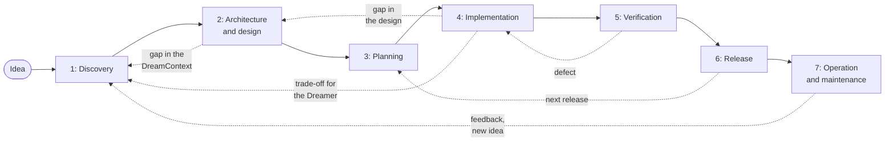

# Software development life cycle

Evo implements ideas that people describe in natural language. This page describes the process that takes one idea from the first conversation to running software: the phases, what each phase produces, and the roles that work in each phase.

The same process serves projects of very different size, from a static one-page site to an enterprise system. The [tier](#project-tiers) of a project sets how deep each phase goes.

This page is about the projects that Evo builds for its Dreamers. The workflow for changing this repository is in [CONTRIBUTING.md](../CONTRIBUTING.md).

Nothing in this repository runs this process yet.

## Terms

| Term | Meaning |
| --- | --- |
| Dreamer | The person who brings the idea, owns it and makes the decisions about it. The Dreamer is the customer of Evo. Evo expects mainly non-technical Dreamers: people who can turn an idea into income, and want to do it fast. |
| Dream | One idea of a Dreamer, and everything Evo produces for it. These documents also call it the project. |
| Darwin | The single point of contact of the Dreamer. Darwin talks with the Dreamer in the Dreamer's language and in non-technical words. See [roles/darwin.md](roles/darwin.md). |
| DreamTeam | The roles that work on a Dream behind Darwin: every role except the Dreamer and Darwin. |
| DreamContext | The internal document of Evo that holds what is known about a Dream, with scores for how ready, how valuable and how real the Dream is. Darwin keeps it. See [dream-context.md](dream-context.md). |
| Point | One statement about a Dream in DreamContext: a requirement, a limit, a detail of a screen. A point is open, provisional or confirmed. See [Status of a point](dream-context.md#status-of-a-point). |
| Demo | A working preview of the part of a Dream that was already discussed. The Dreamer opens it and tries it. Also called a live demo or a mini-release. See [Demos](#demos). |
| BDD scenario | A short example of one behavior in the form Given, When, Then, in the words of the Dreamer's business. It is run as a test. BDD stands for behavior-driven development. |
| Intended user | A person who will use what a Dream produces. A Dreamer who sells shoes is not the intended user of the shoe catalog. The customers are. |
| Role | A set of responsibilities, decisions and outputs. A role is not a person. An LLM agent or a person performs it. One performer can hold several roles on a small project. Several performers can share one role on a large project. The Dreamer is always a person. |
| Artifact | A written output of a phase: a document, a diagram, code, a test report. |
| Tier | The size class of a project. See [Project tiers](#project-tiers). |
| Gate | The decision at the end of a phase that lets the project move on. |

TODO: state which roles LLM agents perform and which roles need a person.

TODO: state where the artifacts of a project are stored.

## Principles

1. **Every project passes every phase. The tier sets the depth.** For a one-page site, a phase can be one paragraph. It is still done. A skipped phase is how a small site goes live without HTTPS or without a privacy notice.
2. **The Dreamer talks to Darwin, and only to Darwin.** No other role contacts the Dreamer. A role that needs an answer gives its question to Darwin. Darwin asks it in the language of the Dreamer and in non-technical words, and brings the answer back.
3. **The Dreamer drives the conversation.** Darwin asks as few questions as it can and does not push. A Dreamer who is questioned too much loses interest. Darwin does not lead the Dreamer to an idea of its own or of the DreamTeam. It gives advice when the Dreamer asks for it.
4. **Show early, then confirm.** Evo shows the Dreamer a working [demo](#demos) of what was discussed as soon as there is something to show. A demo keeps the Dreamer involved, and one look answers what many questions would. What the Dreamer confirms is fixed by a test, so that no later change undoes it silently.
5. **Phases hand over in writing.** A role works from the artifacts of the earlier phases, not from the memory of a conversation. An artifact is complete when a performer with no other knowledge of the project can do the next phase from it.
6. **The Dreamer decides.** Scope, cost, acceptance and go-live are decisions of the Dreamer. A role prepares the decision, Darwin presents it in plain words, and nobody makes it silently.
7. **The author does not approve.** The role that produces an output does not approve it. The role that receives the output, or a reviewer, checks it.
8. **A gap reopens the phase that owns it.** When a later phase finds a missing or wrong decision, the work returns to the phase that owns the decision. The process is a loop, not a waterfall. When the answer needs the Dreamer, for example because something cannot be built as the Dreamer wants it, Darwin takes the trade-off to the Dreamer. An approval that depended on the changed content is asked again.
9. **Everything traces to the idea.** A requirement traces to the words of the Dreamer. A design element, a work item, a piece of code and a test trace to a requirement. Something that traces to nothing is not built.
10. **The simplest solution that meets the requirements wins.** A more complex design needs a requirement that the simpler design cannot meet.

## Project tiers

| Tier | Name | Examples | Typical signs |
| --- | --- | --- | --- |
| 1 | Static site | A site that presents a small business, a landing page, a portfolio, an event page | The content is fixed. The site has no server-side code and no database of its own. It has no user accounts. Anything dynamic, such as a form, a map or analytics, comes from a third-party service. |
| 2 | Small application | A Telegram bot with a product catalog and orders, a mobile app with workout timers, a booking tool for one shop | One application: a web application, a chat bot or a mobile app, with at most one database. It may have user accounts and a few third-party services, such as e-mail, payments or a messenger. The load fits on one small instance. A short downtime is acceptable. |
| 3 | Multi-component product | A SaaS product with a web application and mobile apps, a marketplace | Several deployables: APIs, workers, clients. Background processing. More than one data store. Several integrations. Stated targets for availability and performance. The number of users and the amount of data are expected to grow. |
| 4 | Enterprise system | A claims-processing platform, an extension of an ERP system, a module of a core banking system | Several business domains and several teams. Integration with the existing systems of an organization, including its identity system. Regulatory compliance with audits. Contractual service levels. Migration from a legacy system. Formal change control. |

The tier is set this way:

- The [solution architect](roles/solution-architect.md) sets the tier in Discovery, with the reasons, and records it in DreamContext.
- The tier is the lowest one whose description fits the whole project.
- One concern above the tier does not raise the tier. It engages a role. A one-page site with a payment button stays tier 1 and engages the security architect. Each [role document](roles/README.md) lists these triggers.
- The tier can change. When the project outgrows its tier, the solution architect raises the tier, and each phase is reopened where the new tier asks for more depth.

What the tier changes is in [Phases by tier](#phases-by-tier) and [Roles by tier](#roles-by-tier).

## Roles

| Role | Answers for | Role document |
| --- | --- | --- |
| Dreamer | The idea. Describes it, answers questions, and makes the decisions: scope, cost, acceptance and go-live. Always a person. | [dreamer.md](roles/dreamer.md) |
| Darwin | The conversation with the Dreamer, and DreamContext: what Evo knows about the Dream, and how ready the Dream is for the next phase. | [darwin.md](roles/darwin.md) |
| Product manager | What is built and why: the intended users, the scope of each release, the priorities. | [product-manager.md](roles/product-manager.md) |
| Business analyst | The requirements: complete, unambiguous, testable, and traced to the words of the Dreamer. | [business-analyst.md](roles/business-analyst.md) |
| UX designer | How the product looks and behaves for its users: journeys, screens, content structure, accessibility. | [ux-designer.md](roles/ux-designer.md) |
| Project manager | The plan and its progress: order of work, dependencies, risks, status. | [project-manager.md](roles/project-manager.md) |
| Solution architect | The design of the whole solution: its parts, how they work together, the technology, the cost. | [solution-architect.md](roles/solution-architect.md) |
| Software architect | The structure of the code: modules, contracts, patterns, standards. | [software-architect.md](roles/software-architect.md) |
| Data architect | The data: what is stored, in which shape, where, and for how long. | [data-architect.md](roles/data-architect.md) |
| Infrastructure architect | Where and how the solution runs: hosting, environments, delivery, scaling, recovery. Specializations by provider. | [infrastructure-architect.md](roles/infrastructure-architect.md) |
| Security architect | The protection of the users, the data and the solution: threats, controls, compliance. | [security-architect.md](roles/security-architect.md) |
| AI architect | The use of AI models in the solution: where a model is used, what it may decide, how its quality is measured, what it costs. Has work only when the solution itself uses AI. | [ai-architect.md](roles/ai-architect.md) |
| Tech lead | The quality of the code of an increment: work breakdown, technical guidance, code review. | [tech-lead.md](roles/tech-lead.md) |
| Developer | The code and its unit tests. Specializations: frontend, backend, mobile, AI. | [developer.md](roles/developer.md) |
| QA engineer | The proof that an increment meets its acceptance criteria: test plan, tests, defects. | [qa-engineer.md](roles/qa-engineer.md) |
| DevOps engineer | The path from a commit to a running environment: pipelines, environments as code, deployments. | [devops-engineer.md](roles/devops-engineer.md) |
| Site reliability engineer | The running solution: monitoring, alerts, incidents, capacity. | [site-reliability-engineer.md](roles/site-reliability-engineer.md) |
| Technical writer | The documentation for users and operators: guides, API documentation, release notes, runbooks. | [technical-writer.md](roles/technical-writer.md) |

A role can have specializations: the same role with more knowledge of one area, such as one cloud provider. See [Specializations](roles/README.md#specializations).

The roles are the roles of a Dream. The prompts that let an LLM agent perform a role are part of Evo itself. See [Roles and prompts](roles/README.md#roles-and-prompts).

TODO: describe the roles that a tier 4 project adds and this table does not have, for example a compliance officer, a release manager and a database administrator.

## Phases

The animation shows the diagram below. The diagram is the source: when the two differ, the diagram is right.

Solid arrows are the normal flow. Dashed arrows are returns.

| Phase | Question it answers | Main output | Accountable role | Gate |
| --- | --- | --- | --- | --- |
| [1. Discovery](#1-discovery) | What does the Dreamer want, what exactly is built first, and how do we know that it works? | DreamContext | Darwin | DreamContext is ready. The Dreamer confirms the scope. |
| [2. Architecture and design](#2-architecture-and-design) | How is it built, and what does it cost? | Architecture description | Solution architect | The design passes review. The Dreamer approves the approach and the cost range. |
| [3. Planning](#3-planning) | In which steps is it built? | Delivery plan | Project manager | The Dreamer approves the plan of the next release. |
| [4. Implementation](#4-implementation) | Is it built as designed? | Increment | Tech lead | Every work item is reviewed and merged. |
| [5. Verification](#5-verification) | Does it do what the requirements say? | Test report | QA engineer | The Dreamer accepts the increment. |
| [6. Release](#6-release) | Is it in production, and can it be taken back? | Deployed version | DevOps engineer | The Dreamer authorizes go-live. |
| [7. Operation and maintenance](#7-operation-and-maintenance) | Does it keep working, and what did we learn? | Running solution | Site reliability engineer | None. The Dreamer decides when the solution is retired. |

The phases repeat:

- Phases 3 to 6 repeat for each release.
- Inside a release, phases 4 and 5 repeat for each work item and each defect.
- A return to an earlier phase can come from any later phase. The dashed arrows are the common ones.

The Dreamer sees none of these phases as a border. For the Dreamer there is one conversation with Darwin, from the first message to the running solution.

The letters in the role tables below:

| Letter | Meaning |
| --- | --- |
| A | Accountable. Answers for the output of the phase, and does part of the work. One role in each phase. |
| R | Responsible. Does the work. |
| C | Consulted. Gives input and is asked before a decision. |
| I | Informed. Is told the result. |

An architect role that is not engaged on a project has its work done by the role that covers it. See [Roles by tier](#roles-by-tier). The AI architect takes part only when the solution itself uses AI.

### 1. Discovery

**Purpose:** understand what the Dreamer wants, and make it clear enough to design: the idea, the people it serves, what the first release does, and how to tell that it works.

Discovery covers what other processes split into two phases, discovery and requirements. In Evo it is one phase, because it is one conversation with one output: [DreamContext](dream-context.md).

**The conversation:**

- The Dreamer brings the idea in any language. Darwin answers in that language, in non-technical words.
- The Dreamer drives. Darwin asks the fewest questions that close the gaps, and asks first what changes the Dream most.
- Darwin does not lead the Dreamer to an idea of its own. A solution that the Dreamer names, such as a Telegram bot or an Android app, is taken as given. Darwin gives advice when the Dreamer asks for it.
- The conversation is direct and asynchronous. In the direct part, the Dreamer writes and Darwin answers at once. In the asynchronous part, a role of the DreamTeam reads DreamContext and gives Darwin a question. Darwin takes it to the Dreamer and brings the answer back.
- A small gap can be closed with an assumption and without a question. The assumption is a provisional point in DreamContext. The Dreamer sees it in a demo or when confirming the scope.
- Darwin offers a [demo](#demos) when enough was discussed to show something. After the demo, Darwin asks a few follow-up questions. What the Dreamer confirms is no longer provisional.

**Activities:**

- Keep the description of the Dreamer in the words and the language of the Dreamer.
- Find what is unclear: gaps, words with two meanings, contradictions. Each one lowers the readiness score of DreamContext.
- Record the purpose, the intended users, the wanted outcome, and how the Dreamer will know that it worked.
- Record the limits: budget, deadline, platform, technology or brand that must be used, legal conditions.
- Give every point its status: open, provisional or confirmed. Keep what the Dreamer confirmed apart from what a role assumed.
- Describe the user journeys. Find the smallest end-to-end journey that gives the intended user the outcome.
- Put each capability into one of three groups: first release, later release, out of scope. Keep the later ideas. Do not lose them.
- Write the functional requirements. Give each one acceptance criteria that can be tested.
- Build a demo of what was discussed, when the Dreamer accepts the offer. Record what the Dreamer confirms and what the Dreamer corrects after it.
- Write a BDD scenario for each confirmed point that can be observed in the product.
- Write the quality attributes that apply, with numbers: performance, availability, security, accessibility, supported devices and languages.
- Set the tier and name the roles that are engaged.
- Set the scores of DreamContext: how ready, how valuable and how real the Dream is.

**Outputs:**

- DreamContext, with its parts: the idea brief, the scope in its three groups, the requirements specification with the BDD scenarios of the confirmed points, the open points, the tier and the scores.
- The demos that the Dreamer saw.

**Gate:** DreamContext is ready: its readiness score has reached the threshold. The Dreamer confirms the scope. For that, Darwin says in plain words what is built first, what waits and what is out, with the points that are still provisional.

The threshold is not decided yet. See [Readiness](dream-context.md#readiness).

| Role | | Work in this phase |
| --- | --- | --- |
| Darwin | A | Talks with the Dreamer. Keeps DreamContext and its scores. Takes the questions of the DreamTeam to the Dreamer and brings the answers back. Offers the demos, asks the follow-up questions and records what the Dreamer confirms. |
| Product manager | R | Proposes what is in the first release, what is later and what is out. Sets the priorities. Gives the input for the value score. Says what a demo shows, and checks it before the Dreamer sees it. |
| Business analyst | R | Finds the gaps, the ambiguities and the contradictions. Writes the requirements and the acceptance criteria. Traces each one to the words of the Dreamer. Writes a BDD scenario for each confirmed point. |
| UX designer | R | Describes the user journeys and sketches the main screens. Designs what a demo shows. |
| Solution architect | R | Sets the tier and names the engaged architect roles. Collects the quality attributes and the constraints. Checks that each requirement is feasible. Gives the input for the reality score. |
| Developer | R | Builds the demos. |
| Dreamer | C | Describes the idea and answers questions. Tries the demos, and says what is right and what is wrong. Confirms the scope. |
| Software architect | C | Names the requirements that shape the code structure, such as offline use, several tenants or several languages. |
| Data architect | C | Names the data requirements: what is stored, for how long, what is imported, exported and reported. |
| Infrastructure architect | C | Names the requirements for availability, load, location of the data and running cost. |
| Security architect | C | Classifies the data. Names the compliance and security requirements. |
| AI architect | C | Names where the Dream needs an AI model, and what a wrong answer of the model costs. |
| QA engineer | C | Checks that every acceptance criterion can be tested. |
| Project manager | I | |

### 2. Architecture and design

**Purpose:** decide how the solution is built before it is built: its parts, its technology, its data, its hosting, its protection and its look. State what it costs.

**Activities:**

- Design the solution: the components, the interfaces between them, the external services. Decide what is built, bought or reused.
- Design the code structure, the data model, the infrastructure and the security controls.
- Where the solution uses AI, design each use of a model: the model, what it receives, how its quality is measured, and what happens when it is wrong.
- Design the user interface.
- Where a choice changes the cost, the vendor or the scope, compare the options. Darwin puts the choice to the Dreamer in plain words.
- Estimate the cost of building and the cost of running.
- Record each significant decision and its reasons in an architecture decision record (ADR).
- Test a risky assumption with a prototype before the design depends on it.
- Decide whether the code of a demo from Discovery is kept or thrown away.
- Review the design. Each architect reviews the parts of the other architects that touch their area.
- Give Darwin every gap that the design finds in DreamContext.

**Outputs:**

- The architecture description, with these parts: solution design, code structure and API contracts, data model, infrastructure design, threat model and security controls, and the design of each use of AI where the solution has one. At tiers 1 and 2 the parts are sections of one document. At tiers 3 and 4 they are separate documents.
- The ADRs.
- The user interface design.
- The cost estimate: building and running, each as a range with its assumptions.
- The risk list.

**Gate:** the design passes a review by a role that did not write it. The Dreamer approves the approach and the cost range.

| Role | | Work in this phase |
| --- | --- | --- |
| Solution architect | A | Designs the solution as a whole. Joins the work of the other architects into one consistent design. Prepares the options and the cost for the Dreamer. Decides whether the code of a demo is kept. |
| Software architect | R | Designs the code structure, the API contracts and the code standards. |
| Data architect | R | Designs the data model, the data stores, the data flows and the retention. |
| Infrastructure architect | R | Designs the hosting, the environments, the delivery pipeline, the observability and the recovery. Estimates the running cost. |
| Security architect | R | Writes the threat model. Designs authentication, authorization and the other controls. Reviews the designs of the other architects. |
| AI architect | R | Designs each use of an AI model: the model, what it receives, the evaluation, the fallback and the cost. |
| UX designer | R | Designs the screens, the navigation, the states and the accessibility. |
| Darwin | R | Presents to the Dreamer the options that change cost, vendor or scope, and the cost range, in plain words. Brings the choice and the approval back. |
| Dreamer | C | Chooses between the options that change cost, vendor or scope. Approves the approach and the cost range. |
| Product manager | C | Gives the priorities when a trade-off touches the scope. |
| Business analyst | C | Clarifies the requirements. |
| Tech lead | C | Checks that the design can be built. Builds prototypes. |
| Developer | C | Builds prototypes. |
| QA engineer | C | Checks that the design can be tested. |
| DevOps engineer | C | Checks that the pipeline and the environments can be built. |
| Site reliability engineer | C | Checks that the solution can be operated: what is monitored, and how it fails. |
| Project manager | I | |

### 3. Planning

**Purpose:** cut the design into releases and work items that are small enough to build, to check and to show.

**Activities:**

- Divide the scope into releases. Each release ends with something that the Dreamer can see working.
- Break each release into work items. Each work item has acceptance criteria and traces to a requirement.
- Order the work. First comes a thin slice through all components that can be deployed. Then comes the work with the highest technical risk.
- Find the work items that can be done in parallel.
- Write the test plan: the kinds of tests, the environments and the test data.
- Plan the environments and the pipeline.
- Estimate the effort. Update the cost range if it changes.

**Outputs:**

- The delivery plan: the releases, the work items with acceptance criteria, the order and the dependencies.
- The test plan.
- The updated risk list.

**Gate:** the Dreamer approves the plan of the next release.

| Role | | Work in this phase |
| --- | --- | --- |
| Project manager | A | Builds the plan. Tracks the dependencies and the risks. |
| Product manager | R | Decides which requirement is in which release. |
| Tech lead | R | Breaks the releases into work items and estimates them. |
| QA engineer | R | Writes the test plan. |
| DevOps engineer | R | Plans the work on the environments and the pipeline. |
| Darwin | R | Presents the plan of the next release to the Dreamer, with what the Dreamer has to provide and by when. Brings the approval back. |
| Dreamer | C | Approves the plan of the next release. |
| Business analyst | C | Clarifies the acceptance criteria. |
| Solution architect | C | Advises on the order: the thin end-to-end slice first, then the highest technical risk. |
| Software architect | C | Aligns the work items with the module boundaries and the contracts, so that work can run in parallel. |
| Data architect | C | Orders the schema work and the migration work. |
| Infrastructure architect | C | Orders the environment work. |
| Security architect | C | Checks that the security work and the security tests are in the plan. |
| AI architect | C | Checks that the examples of each evaluation are in the plan before the prompts that they test. |
| Developer | C | Estimates work items. |

### 4. Implementation

**Purpose:** build the work items of the release.

**Activities:**

- Write the code and the unit tests of each work item. Follow the architecture and the code standards.
- Have every change reviewed by someone other than its author.
- Run the pipeline on every change: build, static checks, tests, security scans.
- Build the environments and the pipeline as code.
- Write the automated integration tests and acceptance tests together with the code. Automate the BDD scenarios of the confirmed points first.
- Update the documentation in the same change as the code.
- Record every deviation from the design. The architect who owns the decision accepts the deviation, or the design changes in a new ADR.
- When something cannot be built as the Dreamer wants it, give Darwin the trade-off: what is not possible, and the options that are.

**Outputs:**

- The increment: reviewed and merged code with passing tests.
- The environments and the pipeline.
- The updated documentation.

**Gate:** every work item of the release is merged. Its review has passed, its pipeline run is green, and tests cover its acceptance criteria. This gate needs no decision of the Dreamer.

| Role | | Work in this phase |
| --- | --- | --- |
| Tech lead | A | Guides the developers, reviews code and keeps the increment consistent. |
| Developer | R | Writes code and unit tests. Reviews the code of other developers. |
| QA engineer | R | Automates the integration tests and the acceptance tests, with the BDD scenarios of the confirmed points. |
| DevOps engineer | R | Builds the pipeline and the environments. |
| Technical writer | R | Writes the user documentation and the API documentation. |
| Project manager | R | Tracks the progress and removes blockers. Gives Darwin the status. |
| Darwin | R | Takes the questions of the DreamTeam to the Dreamer. When something cannot be built as the Dreamer wants it, explains the trade-off and brings the decision back. Reports the status. |
| Dreamer | C | Answers the questions that come up. Decides on trade-offs. Receives the status. |
| Product manager | C | Answers questions about the scope. |
| Business analyst | C | Clarifies the requirements. |
| UX designer | C | Clarifies the design. Reviews the built screens. |
| Solution architect | C | Answers design questions. Decides on deviations that cross components. |
| Software architect | C | Reviews changes to the structure, the contracts and the dependencies. |
| Data architect | C | Reviews schema changes and migrations. |
| Infrastructure architect | C | Reviews the infrastructure code and the pipeline. |
| Security architect | C | Reviews security-sensitive changes. Assesses the findings of the security scans. |
| AI architect | C | Reviews the prompts, the calls to a model, and the changes to the examples of an evaluation. |

### 5. Verification

**Purpose:** prove that the increment does what the requirements say, and show it to the Dreamer.

**Activities:**

- Run the tests of the test plan: integration, end-to-end, and acceptance against each criterion.
- Run the BDD scenarios of all confirmed points, also those of the earlier releases.
- Where the solution uses AI, run the evaluation of each use of a model against its threshold.
- Test the quality attributes against their targets, as far as the tier requires: performance, security, accessibility, recovery.
- Record the defects. Fix them in Implementation and test again.
- Verify the data migration and the rollback in an environment that is like production.
- Check that the solution is ready to be operated: monitoring, alerts, runbooks.
- Show the increment to the Dreamer in a [demo](#demos). Ask the follow-up questions, and record what the Dreamer confirms.

**Outputs:**

- The test report: each acceptance criterion and each quality target with its result, and the open defects with their severity.
- The release candidate.

**Gate:** every acceptance criterion of the release passes, and every BDD scenario of a confirmed point from an earlier release still passes, or the Dreamer accepts the exception. No open defect blocks the release. The Dreamer accepts the increment after the demo.

| Role | | Work in this phase |
| --- | --- | --- |
| QA engineer | A | Runs the tests, records the defects and writes the test report. |
| Developer | R | Fixes defects. |
| Tech lead | R | Orders the defect fixes and reviews them. |
| DevOps engineer | R | Provides the test environments. |
| Product manager | R | Checks the increment against the approved scope, before the Dreamer sees it. |
| Security architect | R | Reviews the results of the security tests. Decides which findings block the release. |
| Darwin | R | Shows the increment to the Dreamer in a demo. Asks the follow-up questions. Brings back the acceptance, what the Dreamer confirmed, and the changes that the Dreamer asks for. |
| Dreamer | C | Tries the demo. Accepts the increment or asks for changes. |
| Business analyst | C | Clarifies the expected behavior. |
| UX designer | C | Checks the screens against the design and the accessibility requirements. |
| Solution architect | C | Checks that the quality targets were tested and met. |
| Software architect | C | Checks that the architecture rules hold in the code. |
| Data architect | C | Checks the results of the migration tests and the data integrity tests. |
| Infrastructure architect | C | Defines and reviews the load test, the failover test and the restore test. |
| AI architect | C | Checks the results of the evaluations against their thresholds. |
| Site reliability engineer | C | Checks that the solution is ready to be operated. |
| Technical writer | C | Checks that the documentation matches the behavior. |
| Project manager | I | |

### 6. Release

**Purpose:** put the accepted increment into production, safely and in a way that can be undone.

**Activities:**

- Prepare production: infrastructure, configuration, secrets, access.
- Confirm the way back: a backup exists, and the rollback has been tried.
- Deploy. Run the data migrations.
- Run the smoke tests in production.
- Watch the metrics and the errors after the release. Roll back when the release criteria fail.
- Publish the release notes and the user documentation.

**Outputs:**

- The version that runs in production.
- The release notes.
- The runbooks and the rollback plan.
- The release record: what was deployed, when, and with which result.

**Gate:** before the deployment, the Dreamer authorizes go-live. After it, the smoke tests pass and the monitoring shows a healthy solution.

| Role | | Work in this phase |
| --- | --- | --- |
| DevOps engineer | A | Deploys, runs the migrations, and rolls back when needed. |
| Site reliability engineer | R | Sets up the monitoring and the alerts. Watches the release. Owns the runbooks. |
| QA engineer | R | Runs the smoke tests in production. |
| Technical writer | R | Publishes the release notes and the user documentation. |
| Project manager | R | Coordinates the go or no-go decision of the roles. |
| Darwin | R | Asks the Dreamer for go-live. Tells the Dreamer the result of the release. |
| Dreamer | C | Authorizes go-live. |
| Product manager | C | Confirms the content of the release. |
| Solution architect | C | Confirms that the deployed solution is the accepted design. |
| Software architect | C | Confirms that the release keeps the contracts compatible. |
| Data architect | C | Reviews the migration, the backup before it and the data check after it. |
| Infrastructure architect | C | Reviews the readiness of production: capacity, alerts, rollback, backups. |
| Security architect | C | Confirms that no blocking finding is open, and that access and secrets in production are right. Gives Darwin the remaining risks for the Dreamer. |
| AI architect | C | Confirms the model version, the limits and the budget alert in production. |
| Tech lead | C | Stays available to assess a problem. |
| Developer | C | Stays available to fix a problem. |

### 7. Operation and maintenance

**Purpose:** keep the solution running, safe and current, and learn from its use.

**Activities:**

- Monitor availability, errors, performance and cost.
- Respond to incidents. Write down the cause and the fix of each one.
- Fix defects, update dependencies and apply security patches.
- Test the backups by restoring them.
- Collect the feedback of the Dreamer and of the intended users, and the usage data. Turn them into new ideas and requirements.
- Review the tier when the product grows.
- Retire the solution when the Dreamer decides: export or delete the data, shut down the environments, cancel the services.

**Outputs:**

- The running, monitored solution.
- The incident reports.
- The maintenance releases.
- The feedback and the new ideas.

**Gate:** none. The phase lasts as long as the solution runs. A change goes back through the phases, each at the depth the change needs. The Dreamer decides when the solution is retired.

| Role | | Work in this phase |
| --- | --- | --- |
| Site reliability engineer | A | Monitors the solution, handles incidents and watches the capacity. |
| DevOps engineer | R | Keeps the pipeline and the environments current. Deploys the maintenance releases. |
| Developer | R | Fixes defects and updates dependencies. |
| Tech lead | R | Assesses defects and plans the maintenance work. |
| QA engineer | R | Runs the regression tests of the maintenance releases, with the BDD scenarios of the confirmed points. |
| Product manager | R | Turns the feedback and the usage data into new ideas and requirements. |
| Technical writer | R | Keeps the documentation current. |
| Darwin | R | Collects the feedback of the Dreamer. Tells the Dreamer about incidents. Takes new ideas into Discovery. |
| Dreamer | C | Gives feedback. Is told about incidents. Decides on new work and on retirement. |
| Solution architect | C | Reviews incidents and metrics for causes in the design. Reviews the tier. |
| Software architect | C | Tracks the technical debt and plans framework upgrades. |
| Data architect | C | Watches the growth of the data, slow queries and the retention. |
| Infrastructure architect | C | Reviews the trends of cost and capacity. |
| Security architect | C | Follows new vulnerabilities. Reviews security incidents. Updates the threat model. |
| AI architect | C | Watches the quality and the cost of each use of a model. Plans the change to a new model version. |
| Project manager | I | |

## Demos

A demo is a working preview of the part of a Dream that was already discussed. The Dreamer opens it and tries it. It is also called a live demo or a mini-release.

A demo has two purposes:

- **It keeps the Dreamer involved.** The Dreamer sees the Dream take shape early, and not only at the end of a release.
- **It confirms.** A Dreamer who sees a thing knows at once whether it is right. One look answers what many questions would.

### How a demo works

1. Darwin offers a demo when enough was discussed to show something. The Dreamer can say no.
2. The product manager says what the demo shows: the part that was discussed, and nothing that changes the Dream. Where a detail is still open, a role makes a choice. The choice is a provisional point.
3. The UX designer and the developer build the demo. They give Darwin the list of the choices they made. The product manager checks the demo against DreamContext before the Dreamer sees it.
4. The Dreamer opens the demo and tries it.
5. Darwin asks a few follow-up questions about what the Dreamer saw. Each question names one provisional point, and Darwin asks first about the points that are expensive to change later: "The menu is at the bottom of the screen. Is that the right place, or do you want it at the top or on the left?"
6. Darwin records the result in DreamContext. A point that the Dreamer confirms or corrects in clear words becomes confirmed, with the value that the Dreamer gave. A point that the Dreamer did not speak about stays provisional. Silence does not confirm.
7. A confirmed point that can be observed in the product gets a BDD scenario. From then on a test protects it. See [From a confirmed point to a test](dream-context.md#from-a-confirmed-point-to-a-test).

### When a demo is shown

| Phase | What the demo shows | What follows |
| --- | --- | --- |
| 1. Discovery | What was discussed so far. Discovery can have several demos. | Confirmed points. The readiness score rises. |
| 5. Verification | The increment of the release. | Confirmed points, and the acceptance of the increment. |

### Rules for a demo

- The rules of the conversation hold. The Dreamer drives, and the follow-up questions are few. Darwin does not ask about every detail of the demo.
- A demo does not steer. It shows no idea of the DreamTeam as if it were decided.
- A demo is not public. Only the Dreamer can open it, and it needs no go-live decision.
- A demo is not a prototype. A prototype tests a technical assumption for the architects, and the Dreamer does not see it.
- What a demo in Discovery leaves behind is knowledge: confirmed points and their BDD scenarios. Its code is not the product. The solution architect decides in Architecture and design whether the code is kept or thrown away.

TODO: state where a demo is published and how the Dreamer opens it.

TODO: state who pays for a demo that is built before the Dreamer approves the cost range.

## Responsibility matrix

The matrix repeats the letters of the role tables above. A dash means that the role does not normally take part in the phase. The role documents name the exceptions.

| Role | 1. Discovery | 2. Architecture and design | 3. Planning | 4. Implementation | 5. Verification | 6. Release | 7. Operation and maintenance |
| --- | --- | --- | --- | --- | --- | --- | --- |
| Dreamer | C | C | C | C | C | C | C |
| Darwin | A | R | R | R | R | R | R |
| Product manager | R | C | R | C | R | C | R |
| Business analyst | R | C | C | C | C | - | - |
| UX designer | R | R | - | C | C | - | - |
| Project manager | I | I | A | R | I | R | I |
| Solution architect | R | A | C | C | C | C | C |
| Software architect | C | R | C | C | C | C | C |
| Data architect | C | R | C | C | C | C | C |
| Infrastructure architect | C | R | C | C | C | C | C |
| Security architect | C | R | C | C | R | C | C |
| AI architect | C | R | C | C | C | C | C |
| Tech lead | - | C | R | A | R | C | R |
| Developer | R | C | C | R | R | C | R |
| QA engineer | C | C | R | R | A | R | R |
| DevOps engineer | - | C | R | R | R | A | R |
| Site reliability engineer | - | C | - | - | C | R | A |
| Technical writer | - | - | - | R | C | R | R |

## Phases by tier

Each cell says what the phase produces at that tier. A higher tier produces what the lower tier produces, and more.

| Phase | Tier 1: static site | Tier 2: small application | Tier 3: multi-component product | Tier 4: enterprise system |
| --- | --- | --- | --- | --- |
| 1. Discovery | A short conversation: purpose, audience, content, look, domain. The list of pages and sections, the third-party embeds, and what "done" means. One demo: a first version of the page. | An idea brief of one or two pages. User journeys, functional requirements with acceptance criteria, and the basic quality attributes. A demo of the main journey. | The kinds of intended users and the existing alternatives. Quality attributes with measured targets. The scope of several releases. Requirements for each integration. A demo of each main journey. | Also the stakeholders with their interests, the existing systems and processes that the solution touches, compliance requirements, migration requirements, and a formal sign-off by the named stakeholders. |
| 2. Architecture and design | A note of half a page: how the site is built, where it is hosted, the domain, how the content is updated. | An architecture description of a few pages with one diagram. ADRs for the main choices. A baseline security review. | Separate documents for each part of the architecture. An ADR for each significant decision. A threat model. API contracts. A cost model. | Also the fit with the standards of the organization, the steps of the transition from the legacy system, the compliance mapping, and a review by the architecture board of the organization. |
| 3. Planning | One list of work items. | A plan of a few releases with work items. A short test plan. | A release plan with workstreams and dependencies. A test plan for each kind of test. | A plan across teams, with the dependencies between them, and the change control of the organization. |
| 4. Implementation | One developer builds the site. | One small team builds the application. Every change is reviewed and passes the pipeline. | Several developers work in parallel against the agreed contracts. | Several teams work in parallel. Shared standards and templates keep them consistent. |
| 5. Verification | Links, forms, display on phone and desktop, loading speed, accessibility, spelling. | Unit tests, integration tests and acceptance tests. Checks against the security baseline. | Also end-to-end tests across components, performance tests, security tests and a restore test. | Also user acceptance testing by the organization, a penetration test, a failover test and audit evidence. |
| 6. Release | Publish to the static host. Check the domain and HTTPS. | Deploy through the pipeline to production, with a backup before and a rollback path. | A staged rollout with no downtime. Migrations that can be rolled back. | Release windows, the change approval of the organization, and a rollout by region or by group of users. |
| 7. Operation and maintenance | An uptime check. Renewal of the domain. Updates of the content. | Monitoring with alerts, backups, updates of dependencies. | Service level objectives, an on-call duty, an incident process, capacity reviews. | Contractual service levels, audits, recovery drills, and reporting to the organization. |

At tier 1 the gates are merged:

- Phases 1 to 3 have one gate. Darwin gives the Dreamer one short summary: what is built, what it costs, and when it is ready. The Dreamer approves it.
- Phases 5 and 6 have one gate. The Dreamer tries the demo of the finished site and approves its publication.

## Roles by tier

"Separate" means that the role is performed on its own. An arrow names the role that also does this role's work at that tier.

| Role | Tier 1 | Tier 2 | Tier 3 | Tier 4 |
| --- | --- | --- | --- | --- |
| Dreamer | One person | One person | One person or a few | Several stakeholders. One of them is named as the decision-maker of each gate. |
| Darwin | Separate | Separate | Separate | Separate |
| Product manager | Separate | Separate | Separate | Separate, one for each product area |
| Business analyst | → Product manager | → Product manager | Separate | Separate, several |
| UX designer | Separate | Separate | Separate | Separate, several |
| Project manager | → Product manager | Separate | Separate | Separate, with one plan across the teams |
| Solution architect | Separate | Separate | Separate | Separate |
| Software architect | → Solution architect | Separate | Separate | Separate, one for each domain |
| Data architect | → Solution architect | → Software architect | Separate | Separate |
| Infrastructure architect | → Solution architect | → Solution architect | Separate | Separate |
| Security architect | → Solution architect | Separate | Separate | Separate |
| AI architect | → Solution architect | → Solution architect | Separate | Separate |
| Tech lead | → Developer | → Software architect | Separate | Separate, one for each team |
| Developer | Separate | Separate | Separate, several by specialization | Separate, several teams |
| QA engineer | Separate | Separate | Separate | Separate, with specialists for performance and security tests |
| DevOps engineer | → Developer | Separate | Separate | Separate |
| Site reliability engineer | → Developer | → DevOps engineer | Separate | Separate |
| Technical writer | → Developer | → Developer | Separate | Separate |

Three rules apply when roles are combined:

- The combined role does the work of each role it holds, at the depth of the tier. Combining roles removes hand-overs. It does not remove work.
- The principle "the author does not approve" still holds. The developer and the QA engineer are never the same performer.
- A trigger engages a role at a tier where the table shows it as covered. The triggers of each role are in its [role document](roles/README.md).

The row of the AI architect applies only when the solution itself uses AI. On a Dream without a model in its product, the role has no work at any tier.
