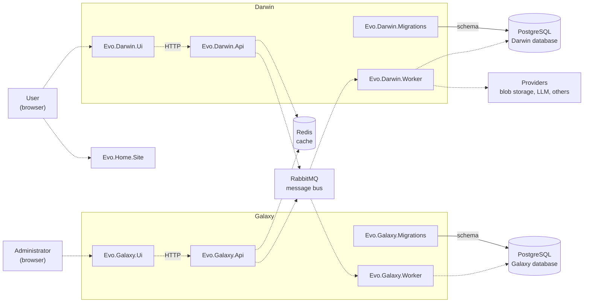
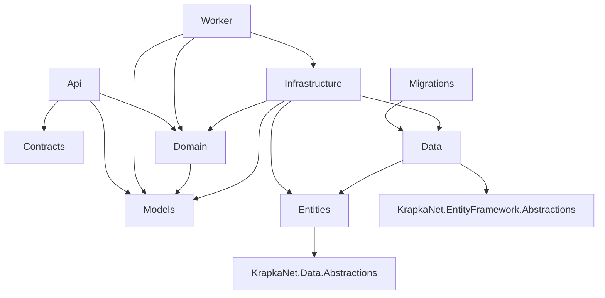

# Architecture overview

This repository holds the services of the Evo project. This page shows the services and their components, what each component may reach, how projects are named, and which project may reference which.

## Services

| Service | Purpose | Components |
| --- | --- | --- |
| Darwin | TODO: describe in two or three sentences what Darwin does and who uses it. | UI, API, Worker, Migrations |
| Galaxy | The administration of Evo. | UI, API, Worker, Migrations |
| Home | The home site of Evo: a few static pages. | Site |

[Krapka](#krapka) is not a service. It is a set of shared libraries from another repository.

The reasons for this split are recorded in [ADR 0003](../adr/0003-services-and-components.md).

## Components

Solid arrows work today. Dashed arrows are planned by the project structure and not built yet.

Darwin and Galaxy have the same four components, with the same rules:

| Component | What it is | May reach | Must not reach |
| --- | --- | --- | --- |
| UI | A JavaScript application in the browser. Not built yet. | The API of its service, over HTTP | Anything else |
| API | An ASP.NET Core web application. It accepts the requests of the UI. | The cache (Redis) and the message bus (RabbitMQ) | The database, blob storage, an LLM or another provider |
| Worker | A .NET console application behind the message bus. It processes the requests that the API sends. | The message bus, the database (PostgreSQL), and the providers: blob storage, an LLM and other external systems | |
| Migrations | A .NET console application. It applies the schema changes to the database of its service, then exits. | The database | |

`Evo.Home.Site` is a set of static pages: basic information about Evo, and how to get the app from Google Play and from the App Store. It reaches no other component.

A request passes through the components in this order:

1. The UI calls the API over HTTP.
2. The API maps the request to a Models type and calls a service in Domain. It may read and write the cache.
3. For work that needs the database or a provider, the API sends a message over RabbitMQ.
4. A Worker receives the message and calls a service in Domain. Infrastructure reads and writes the database and calls the providers.

The Worker is the component that is scaled with the load: several Workers can take messages at the same time. Each service starts with one Worker.

TODO: describe how the result of a Worker returns to the API: a reply on the message bus, a value in the cache, or another way.

TODO: state whether Darwin and Galaxy use two databases on one PostgreSQL server or two servers. Each has its own context and its own connection string.

TODO: describe how Galaxy reads and changes the data of Darwin. It is not decided.

TODO: name the blob storage, the LLM and the other providers. State which of them the Galaxy Worker uses.

TODO: state whether the mobile apps call `Evo.Darwin.Api`.

## Naming

Every .NET project and every UI folder is named `<Project>.<Service>.<Component>`:

| Part | Value here | Meaning |
| --- | --- | --- |
| Project | `Evo` | The project the service belongs to. |
| Service | `Darwin`, `Galaxy`, `Home` | The service. |
| Component | `Api`, `Worker`, `Domain`, ... | One part of the service. |

All components of a service share its prefix, for example `Evo.Darwin.`. New components follow the same convention.

The projects of a service are in one folder, named after the service: `src/Darwin/`, `src/Galaxy/` and `src/Home/`. The test projects are in `tests/Darwin/` and `tests/Galaxy/`. `Evo.sln` has the same folders.

The folder `src/Docker/` is not a service. It holds the Docker Compose project that runs the APIs, the Workers and the home site on one machine: see [Deployment](#deployment). In `Evo.sln` it is the project `docker-compose`, in the folder `src`.

The Krapka projects keep the names they have in their own repository: `KrapkaNet.<Area>.<Name>`.

`evo-darwin` is the kebab-case form of `<project>-<service>`. It names the Helm chart, the chart folder, the Kubernetes namespace and the Kubernetes resources of Darwin.

The reasons are recorded in [ADR 0001](../adr/0001-repository-structure.md).

## Projects

The table lists the projects of Darwin. Galaxy has the same projects with the prefix `Evo.Galaxy.`, the same responsibilities and the same allowed references.

| Project | Responsibility | May reference |
| --- | --- | --- |
| [`Evo.Darwin.Ui`](../../src/Darwin/Evo.Darwin.Ui/README.md) | The browser UI. A folder with a README today. | No .NET project |
| [`Evo.Darwin.Api`](../../src/Darwin/Evo.Darwin.Api/README.md) | Host. HTTP endpoints, `Program.cs`, configuration, the clients of Redis and RabbitMQ. Maps between Contracts and Models. | Contracts, Models, Domain |
| [`Evo.Darwin.Worker`](../../src/Darwin/Evo.Darwin.Worker/README.md) | Host. Message consumers, `Program.cs`, configuration, the client of RabbitMQ. | Models, Domain, Infrastructure |
| [`Evo.Darwin.Migrations`](../../src/Darwin/Evo.Darwin.Migrations/README.md) | Host. The migration classes, and the program that applies them. | Data |
| [`Evo.Darwin.Contracts`](../../src/Darwin/Evo.Darwin.Contracts/README.md) | The request and response types of the external API. | No other project |
| [`Evo.Darwin.Models`](../../src/Darwin/Evo.Darwin.Models/README.md) | The types used on the message bus and in the business layer. | No other project |
| [`Evo.Darwin.Entities`](../../src/Darwin/Evo.Darwin.Entities/README.md) | The classes that describe the database tables. | `KrapkaNet.Data.Abstractions` |
| [`Evo.Darwin.Domain`](../../src/Darwin/Evo.Darwin.Domain/README.md) | The business logic (services). Works with Models only. | Models |
| [`Evo.Darwin.Data`](../../src/Darwin/Evo.Darwin.Data/README.md) | The EF Core context and the mapping of the entities to the tables. | Entities, `KrapkaNet.EntityFramework.Abstractions` |
| [`Evo.Darwin.Infrastructure`](../../src/Darwin/Evo.Darwin.Infrastructure/README.md) | Repositories and providers. Maps between Entities and Models. | Domain, Models, Entities, Data |
| [`Evo.Darwin.UnitTests`](../../tests/Darwin/Evo.Darwin.UnitTests/README.md) | Unit tests. | Domain today; add the project under test when needed |
| [`Evo.Darwin.IntegrationTests`](../../tests/Darwin/Evo.Darwin.IntegrationTests/README.md) | Tests that call the API over HTTP through `WebApplicationFactory`. | Api |

The README of each Galaxy project is in its folder: [Ui](../../src/Galaxy/Evo.Galaxy.Ui/README.md), [Api](../../src/Galaxy/Evo.Galaxy.Api/README.md), [Worker](../../src/Galaxy/Evo.Galaxy.Worker/README.md), [Migrations](../../src/Galaxy/Evo.Galaxy.Migrations/README.md), [Contracts](../../src/Galaxy/Evo.Galaxy.Contracts/README.md), [Models](../../src/Galaxy/Evo.Galaxy.Models/README.md), [Entities](../../src/Galaxy/Evo.Galaxy.Entities/README.md), [Domain](../../src/Galaxy/Evo.Galaxy.Domain/README.md), [Data](../../src/Galaxy/Evo.Galaxy.Data/README.md), [Infrastructure](../../src/Galaxy/Evo.Galaxy.Infrastructure/README.md), [UnitTests](../../tests/Galaxy/Evo.Galaxy.UnitTests/README.md), [IntegrationTests](../../tests/Galaxy/Evo.Galaxy.IntegrationTests/README.md). The home site has one folder: [`Evo.Home.Site`](../../src/Home/Evo.Home.Site/README.md).

The code that exists today, in each of the two services:

- The Api has a health endpoint and no business features.
- The Worker starts and waits. It has no consumer.
- Migrations applies the pending migrations. No migration exists.
- Data has a context with no tables.
- The other projects are empty class libraries with the references above.
- The UI folders hold only a README.
- `Evo.Home.Site` holds one static page, its icon and its background. No pipeline deploys it.

## Rules

- A request arrives as a Contracts type. The Api maps it to a Models type and calls Domain.
- Domain works with Models only. It does not know the external API or the database tables.
- The Api and the Worker exchange Models types on the message bus.
- Infrastructure maps between Models and Entities when it reads from or writes to the database.
- The Api has no access to the database or to a provider.
- The Api never returns Entities.
- Contracts types never reach Domain, the Worker or Infrastructure.
- Only Migrations changes the schema of the database.
- No project of one service references a project of another service. Darwin and Galaxy share code only through Krapka.

The compiler enforces the rules about the Api and about Contracts, through the project references:

- The Api references neither Infrastructure nor Data, so it cannot use the context, a repository, a provider or an entity.
- Domain, the Worker and Infrastructure do not reference Contracts.

The compiler does not enforce the rule about the schema. The Worker reaches the context through Infrastructure, and EF Core lets any code that has a context apply migrations. Reviewers check that only Migrations does it.

The compiler does not stop a Domain service that runs in the Api from asking for a repository or a provider through an interface. The Api registers no implementation of such an interface, so the service fails when the Api starts or when the service is first used.

## Krapka

Krapka is a set of shared .NET libraries in its own open-source repository, <https://github.com/artdolya/krapka>. The components that Darwin and Galaxy have in common are meant to live there.

This repository uses the Krapka libraries as source, not as NuGet packages:

- `src/Krapka` is a symbolic link to `../../krapka`: a checkout of the Krapka repository in the folder next to this repository. The link is committed. The checkout is not part of this repository.
- A project references a Krapka project with a `ProjectReference`. The path starts with the property `KrapkaNetRoot`, which `Directory.Build.props` sets to `src/Krapka/src/Net/`.
- The referenced Krapka projects are in `Evo.sln`, in the solution folder `Krapka`. `dotnet build` builds them from source, for every target framework they declare.
- The Krapka projects use the `Directory.Build.props` and the `Directory.Packages.props` of their own repository, not the ones of this repository.

Two Krapka projects are referenced today:

| Krapka project | Referenced by | Used for |
| --- | --- | --- |
| `KrapkaNet.Data.Abstractions` | `Evo.Darwin.Entities`, `Evo.Galaxy.Entities` | The base classes of the entities. |
| `KrapkaNet.EntityFramework.Abstractions` | `Evo.Darwin.Data`, `Evo.Galaxy.Data` | `ApplicationDbContext`, the base class of the contexts. |

A file under `src/Krapka` belongs to the Krapka repository. A change to it is committed and pushed there, not here. Do not copy Krapka code into this repository. `make format` and the CI formatting check leave the Krapka files out.

The reasons, and the plan to move to NuGet packages later, are recorded in [ADR 0004](../adr/0004-krapka-as-source.md).

## Deployment

Only `Evo.Darwin.Api` is deployed. The Dockerfile in `deploy/docker/`, the Helm chart `evo-darwin` and the Terraform code deploy it alone. It runs in Kubernetes, in the namespace `evo-darwin`, and listens on port 8080. The Kubernetes probes call `GET /health`. See [the deploy runbook](../runbooks/deploy.md).

For local development, the Docker Compose project in `src/Docker/` builds an image of each API and of each Worker, and runs them with the home site, PostgreSQL, Redis and RabbitMQ on one machine. No pipeline builds these images, and they are not deployed. The Migrations programs have no image. A developer runs them from the command line against the PostgreSQL of the stack. See [src/Docker/README.md](../../src/Docker/README.md).

TODO: build and deploy `Evo.Darwin.Worker`, and run `Evo.Darwin.Migrations` before a new version starts. Their images need the Krapka sources, which are outside the Docker build context of this repository. The images of the local stack get the Krapka checkout as a second build context.

TODO: build and deploy the Galaxy components, the two UIs and the home site.

TODO: state where Redis, RabbitMQ and PostgreSQL run in each environment, and how the components get their addresses and credentials.

TODO: describe how traffic from outside the cluster reaches the APIs and the UIs. The Helm chart creates only a `ClusterIP` Service, which is reachable inside the cluster.
