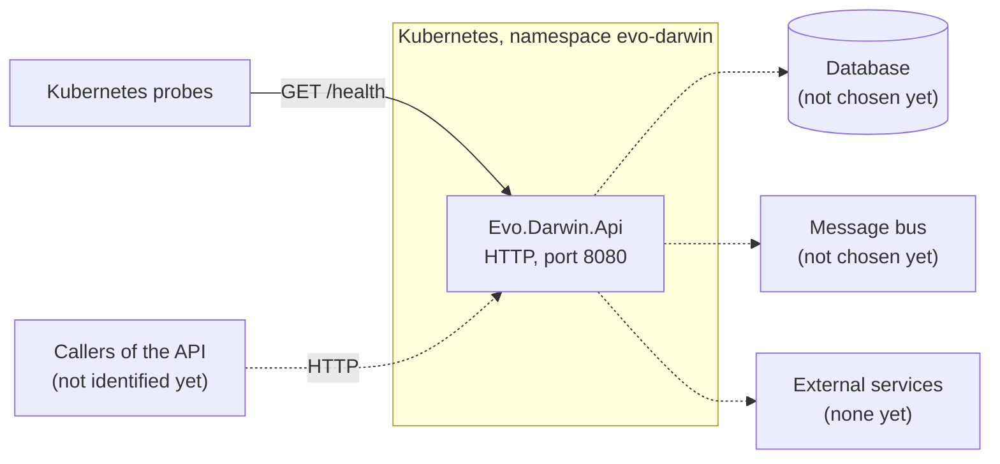
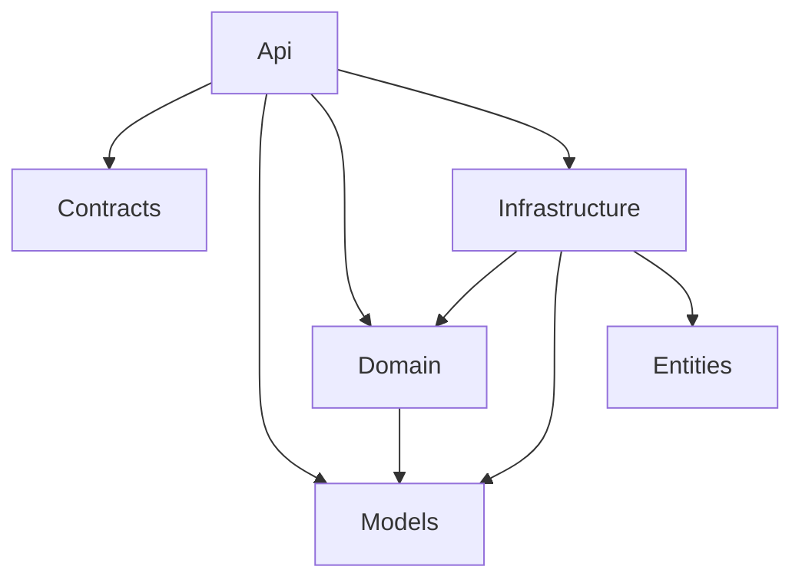

# Architecture overview

Evo.Darwin is one deployable service: the `Evo.Darwin.Api` host, packaged as a container image and run in Kubernetes. This page shows what surrounds it, how projects are named, and what each project is for.

## Context

Solid arrows exist today. Dashed arrows are planned by the project structure and not built yet.

TODO: name the callers of the API (services, front ends, people).

TODO: name the database engine and where it runs. `Evo.Darwin.Infrastructure` is the project that will access it.

TODO: name the message bus. `Evo.Darwin.Models` holds the types that are sent on it.

TODO: list the external services that the service calls.

TODO: describe how traffic from outside the cluster reaches the service. The Helm chart creates only a `ClusterIP` Service, which is reachable inside the cluster.

## Naming

Every .NET project is named `<Project>.<Service>.<Component>`:

| Part | Value here | Meaning |
| --- | --- | --- |
| Project | `Evo` | The project the service belongs to. |
| Service | `Darwin` | The service. |
| Component | `Api`, `Domain`, ... | One part of the service. |

A service usually grows into several components (`Api`, `Worker` and others) while the project name stays. All of them share the `Evo.Darwin.` prefix. New components follow the same convention.

`evo-darwin` is the kebab-case form of `<project>-<service>`. It names the Helm chart, the chart folder, the Kubernetes namespace and the Kubernetes resources.

The reasons are recorded in [ADR 0001](../adr/0001-repository-structure.md).

## Projects

| Project | Responsibility | May reference |
| --- | --- | --- |
| [`Evo.Darwin.Api`](../../src/Evo.Darwin.Api/README.md) | The host: HTTP endpoints, `Program.cs`, configuration. Maps between Contracts and Models. | Contracts, Models, Domain, Infrastructure |
| [`Evo.Darwin.Contracts`](../../src/Evo.Darwin.Contracts/README.md) | The request and response types of the external API. | No other project |
| [`Evo.Darwin.Models`](../../src/Evo.Darwin.Models/README.md) | The types used on the message bus and in the business layer. | No other project |
| [`Evo.Darwin.Entities`](../../src/Evo.Darwin.Entities/README.md) | The classes that describe the database tables. | No other project |
| [`Evo.Darwin.Domain`](../../src/Evo.Darwin.Domain/README.md) | The business logic (services). Works with Models only. | Models |
| [`Evo.Darwin.Infrastructure`](../../src/Evo.Darwin.Infrastructure/README.md) | Database access (`DbContext`, migrations) and external clients. Maps between Entities and Models. | Domain, Models, Entities |
| [`Evo.Darwin.UnitTests`](../../tests/Evo.Darwin.UnitTests/README.md) | Unit tests. | Domain today; add the project under test when needed |
| [`Evo.Darwin.IntegrationTests`](../../tests/Evo.Darwin.IntegrationTests/README.md) | Tests that call the API over HTTP through `WebApplicationFactory`. | Api |

Only `Evo.Darwin.Api` has code today. The other five projects in `src/` are empty class libraries with the references above. Each project name in the table links to the README of the project.

## Rules

- A request arrives as a Contracts type. The Api maps it to a Models type and calls Domain.
- Domain works with Models only. It does not know the external API or the database tables.
- Infrastructure maps between Models and Entities when it reads from or writes to the database.
- The Api never returns Entities.
- Contracts types never reach Domain or Infrastructure.

The compiler enforces the last rule: Domain and Infrastructure do not reference Contracts. It does not enforce the rule before it. The Api references Infrastructure, and .NET makes the Entities types visible to the Api through that reference. Reviewers check that the Api does not use them.
